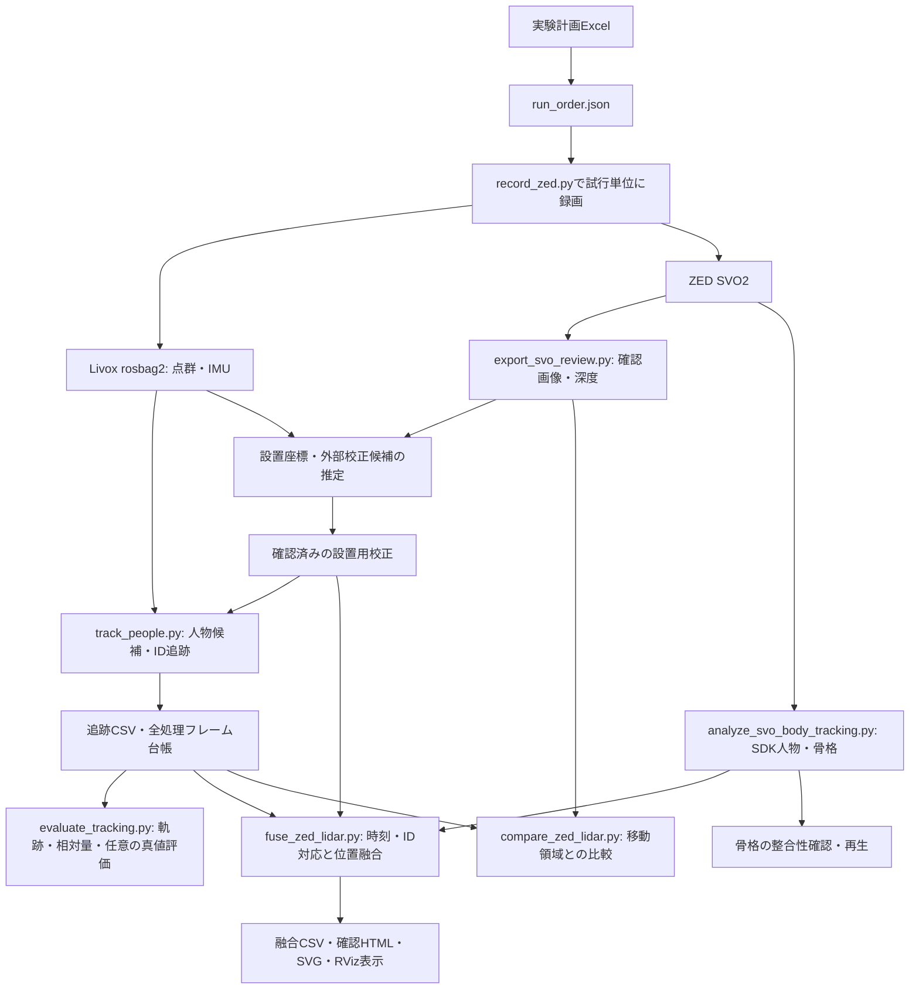

# 歩行実験プログラムの処理と解析アルゴリズム

この文書は、現行の `scripts/` を読みながら、入力データがどのように人物位置・骨格・評価指標になるかを理解するための解説である。2026-10-22時点の実装を対象にする。実行手順は [README](../README.md)、映像との照合と独立真値の作成は [軌跡の人手確認手順](trajectory_human_review.md)を参照する。

## 1. 処理全体の流れ

LiDARは点の集まりから人らしい移動物体を探す。ZEDはSDKによって画像・深度から人物と骨格を推定する。この2つは別の推定であり、時刻・座標・人物IDを対応させてから位置を融合する。



矢印はデータの依存関係を示す。すべてのプログラムを毎回実行する必要はない。校正候補は確認してから使い、実験条件・役割は `run_order.json` を参照する。

## 2. ファイルの役割と入力・出力

リンク先はすべて現行のプログラムである。退避先の `不要なもの/` にある旧版・過去の解析結果とは区別する。

| 目的 | プログラム | 主な入力 → 出力 |
| --- | --- | --- |
| 計画生成・照合 | [build_run_order.py](../scripts/build_run_order.py)、[experiment_plan.py](../scripts/experiment_plan.py) | Excel → `run_order.json`、照合表 |
| 録画・進捗 | [record_zed.py](../scripts/record_zed.py)、[recording_progress.py](../scripts/recording_progress.py) | 計画・設定 → SVO2、bag、録画メタデータ、Take履歴 |
| LiDAR追跡 | [track_people.py](../scripts/track_people.py)、[assignment.py](../scripts/assignment.py) | 点群 → 追跡CSV、`.frames.csv`、`.metadata.json` |
| 座標変換 | [sensor_transform.py](../scripts/sensor_transform.py)、[corridor_frame.py](../scripts/corridor_frame.py) | 校正値・位置・速度 → 変換後の値 |
| 廊下座標の推定 | [estimate_corridor_frame.py](../scripts/estimate_corridor_frame.py) | 保存bag → 廊下座標JSON |
| センサー間校正候補 | [calibrate_zed_lidar_planes.py](../scripts/calibrate_zed_lidar_planes.py)、[calibrate_zed_lidar_aruco.py](../scripts/calibrate_zed_lidar_aruco.py) | 両センサーの平面観測 → 外部校正候補、残差レポート |
| ZED確認画像 | [export_svo_review.py](../scripts/export_svo_review.py) | SVO2 → 画像、任意の深度・IMU、画像台帳、`camera.json` |
| ZED人物・骨格 | [analyze_svo_body_tracking.py](../scripts/analyze_svo_body_tracking.py) | SVO2 → `frames.csv`、`bodies.csv`、`camera.json`、確認画像 |
| 背景差分比較 | [compare_zed_lidar.py](../scripts/compare_zed_lidar.py) | 確認画像・深度、追跡CSV → 比較HTML、画像資材、CSV・JSON |
| 位置融合 | [fuse_zed_lidar.py](../scripts/fuse_zed_lidar.py) | SDK人物CSV、追跡CSV、校正 → 融合CSV、ID対応、集計JSON、HTML |
| 軌跡の評価 | [evaluate_tracking.py](../scripts/evaluate_tracking.py) | 追跡CSV・全フレーム台帳、任意の真値 → 集計、相対量、微分値、HTML |
| 融合グラフ | [plot_fused_trajectory.py](../scripts/plot_fused_trajectory.py) | 融合CSV → 軌跡・速度・関節角のSVG、レポート |
| 時計・設置の確認 | [audit_recordings.py](../scripts/audit_recordings.py) | 保存bag・設定 → 時刻の連続性、遅延、重力方向の集計 |
| 保存画像の重ね合わせ | [render_sensor_review.py](../scripts/render_sensor_review.py) | 画像・bag・追跡CSV → 点群投影画像、廊下平面図、来歴JSON |
| ブラウザで軌跡再生 | [replay_tracks_csv.py](../scripts/replay_tracks_csv.py) | 追跡CSV → `tracking_replay.html` を使った再生HTML |
| 骨格の確認・再生 | [build_walk_skeleton_replay.py](../scripts/build_walk_skeleton_replay.py)、[assess_skeleton_export.py](../scripts/assess_skeleton_export.py)、[compare_approach_tracking.py](../scripts/compare_approach_tracking.py) | 録画用bundle・SDK出力 → 再生HTML、形状確認、接近区間比較 |
| 同期再生 | [replay_zed_lidar.py](../scripts/replay_zed_lidar.py)、[playback_timeline.py](../scripts/playback_timeline.py) | SVO2・bagの記録時刻 → 再生プロセスの開始時刻調整 |
| ROS表示 | [replay_tracking_rviz.py](../scripts/replay_tracking_rviz.py)、[replay_fused_trajectory_rviz.py](../scripts/replay_fused_trajectory_rviz.py)、[convert_livox_custom.py](../scripts/convert_livox_custom.py) | 保存点群・追跡結果 → ROS 2配信、RViz表示用マーカー・点群 |

## 3. 最初にそろえる座標系と時刻

### 3.1 座標系と単位

| 列名・表現 | 意味 | 注意 |
| --- | --- | --- |
| `x,y,z`、`vx,vy` | 元のLiDAR点群座標での位置・速度 | センサーの取り付け傾斜を含む |
| `level_*` | 重力方向をZにそろえた水平化座標 | 重力・床高の設定に依存する |
| `corridor_*` | 廊下方向X・横方向Y・高さZ | 原点・軸は廊下校正に依存する |
| `zed_*` | LiDAR位置をZED左眼のIMAGE座標へ変換した値 | X右・Y下・Z前。ZED自身の測定値とは別 |
| `position_camera_*_m`、SDK関節 | ZED自身が推定したカメラ座標 | エクスポーターでIMAGE座標・mを指定する |

位置・深度はm、速度はm/s、時刻は整数nsを基本にする。ZED SDKの既定単位に任せず、書き出し処理で `UNIT.METER` を明示している。

剛体変換は列ベクトル表記で次になる。

```text
変換後の位置 = R × 元の位置 + t
変換後の速度 = R × 元の速度
元の位置     = R^T × (変換後の位置 − t)
```

`R` は回転、`t` は原点の移動量。コードで点群を行ベクトルとして並べた場合は `points @ R.T + t` と書く。速度には並進を足さない。

水平化では上向き重力ベクトルを+Zへ合わせ、床の設定高を引く。廊下座標ではXYから中心線上の原点を引き、廊下軸・横軸との内積を取る。廊下方向の原点はセンサー原点を中心線へ投影した位置であり、測量した固定ランドマークとは限らない。

`load_settings()` は元LiDAR→ZED変換に水平化の逆変換を合成する。この戻り値を使う処理で、さらに同じ水平化を重複して合成しないように読む。設置移動後の重力・床高・廊下座標・外部校正は再確認する。

### 3.2 時計の種類とoffsetの符号

LiDARはメッセージのヘッダー時刻を優先し、ヘッダーがない、または0の場合だけbag記録時刻へ代替する。オフライン追跡の `.frames.csv` に使用時刻・bag時刻・時刻源を記録する。追跡器は同じ時刻や逆行した時刻を受け付けない。

ZEDは各画像のSDK時刻を取得する。絶対時計を合わせる融合処理と投影レビューでは、次の規約を使う。

```text
LiDARの対応時刻[ns] = ZED画像時刻[ns] + timestamp_offset_ms × 1,000,000
```

一方、`compare_zed_lidar.py` の `--lidar-time-offset-s` は、両方の「先頭からの経過秒」の差を扱う。録画開始差を含むため、絶対時計のoffsetと同じ数値には限らない。異なる引数へ値をそのまま転記しない。

`audit_recordings.py` はヘッダー間隔・時刻逆行・bag時刻との差・IMU平均を集計する。再生開始時刻の調整や静止物の点群の時刻近接だけでは、動く人物に対する同期精度を証明できない。offsetは録画ごとに根拠と一緒に残す。

## 4. LiDARの人物検出・追跡

入口は `PeopleTracker.update()`。`preprocess()` → `detect_clusters()` → 静的候補除去 → `_assignment()` → 状態更新の順に進む。学習済み人物認識モデルではなく、形状・滞在頻度・移動の規則を組み合わせた追跡である。

### 4.1 前処理と背景除去

1. XYZをN×3配列にし、必要なら重力水平化する。非有限値とROI外の点を除く。高さ条件は、この処理座標で判定する。
2. 床を `fixed`（設定値）、`auto`（高さ分布の低い帯で最多のビン）、無効のいずれかで扱う。床近くの点と上限より高い点を除く。
3. `floor(座標 / voxel_size)` が同じ点を1点に間引く。重心への置換ではなく、そのボクセルで最初の点を残す。
4. `BackgroundModel` が、同じボクセルの出現フレーム数を数える。点が多いだけでは回数を増やさず、1フレームにつき1回とする。学習期間後、出現頻度が高い場所を静的背景として除去する。点単位の出現回数は学習後も更新する。
5. `PersistentClusterModel` が、初期学習中に同じ場所へ繰り返し出るクラスタ中心を蓄える。学習後は静的候補中心を固定し、その近傍を除く。壁の揺れや設備からIDが生まれるのを抑える。こちらの学習期間中は人物候補を返さない。

冒頭から人物が同じ位置に居続けると背景に取り込まれ得る。背景学習中に検出が出ない区間も、処理済みフレーム台帳には残る。

### 4.2 近接点のクラスタリング

`_cluster_labels()` は空間格子で近傍点を探し、距離が条件内の点同士をUnion-Findで結ぶ。同じ連結成分を1クラスタとする。DBSCANのようなコア点密度の判定は行わない。

遠距離は点が疎になるため、点対の平均3D距離に応じて接続距離を広げる。

```text
許容接続距離 = min(上限, 基本距離 + 増加率 × max(0, 点対の平均3D距離 − 遠距離開始値))
```

近距離は細かい格子で処理し、拡張した探索は遠距離と境界付近に絞る。クラスタを作った後、点数、高さ、XYの幅・奥行き、床からの下端高で人らしい候補を選ぶ。候補の遠近判定には中心の水平距離を使う。

代表位置はXYZ各成分の中央値。これは骨盤や身体重心ではなく、観測された点群の代表点である。`confidence` は点数に基づく支持度の目安で、人物である確率や位置誤差の確率ではない。

### 4.3 ID対応と位置・速度更新

各IDの等速予測位置 `p + v × Δt` と候補中心の水平距離を求める。`association_prediction` が無効の場合は直前位置を使う。`max_match_distance` を超える組は対応させない。

`assignment.py` のハンガリアン法は、まず有効な対応数を最大にし、その中で水平距離の二乗和を最小にする。未対応を許すダミー列を設けるため、遠い候補へ強制的に割り当てない。

対応が見つかると位置を観測値へ更新する。速度は最後の実観測からの位置差と時間差で求め、指数平滑化する。

```text
観測速度 = (今回の観測位置 − 前回の実観測位置) / 実観測間の秒数
更新速度 = (1 − α) × 以前の速度 + α × 観測速度
```

`α` は `velocity_smoothing`。水平速度を設定上限に制限し、内部追跡座標の鉛直速度は0にする。実観測がない場合は等速予測だけを進め、見失いフレーム数と最終実観測からの秒数の上限でIDを終了する。未対応の新しい候補には新規IDを発行する。

### 4.4 候補・確定・予測の区別

| `status` | 意味 | 確定人物検出として数えるか |
| --- | --- | --- |
| `tentative` | 人らしい候補だが、確定条件を満たしていない | 数えない |
| `confirmed` かつ `detected=1` | 確定済みIDを、そのフレームで実観測した | 数える |
| `predicted` | 確定済みIDを現在は観測できず、等速で予測している | 数えない |

確定には総ヒット数と連続ヒット数を要求する。通常設定では、さらに履歴長、開始位置からの最大変位、妥当な移動の観測回数、移動の一貫性、平均支持点数を要求する。

```text
移動の一貫性 = 最近の履歴の始終点間距離 / 最近の履歴の移動距離の合計
```

同じ方向へ進めば1に近く、同じ場所で揺れるだけなら小さい。遠距離では支持点数条件を緩和する。`min_track_displacement` が0以下の場合は実装上この追加の移動条件を省略するため、設定を確認して読む。確定後の一時停止を毎回未確定へ戻す処理はしない。

パラメータの実値は `config.json` の `tracking` と `TrackerSettings` の未指定時既定値を参照する。

## 5. ZEDの画像・深度・骨格抽出

### 5.1 確認画像と骨格推定は別の出力

`export_svo_review.py` は指定秒数とFPSから取り出し間隔を決め、補正済み左画像を保存する。深度指定時にはNEURAL深度のm値も保存し、内部パラメータ、画像時刻、任意のIMU値を台帳に記録する。人物・骨格推定は行わない。

`analyze_svo_body_tracking.py` はSDKの `HUMAN_BODY_ACCURATE`、`BODY_34`、追跡・body fitting・segmentationを有効にする。固定設置を想定して位置追跡を静的設定で初期化する。ニューラル推論や骨格モデルの当てはめはSDK側の処理であり、このリポジトリでモデルを学習しているわけではない。

各フレームで人物ID・追跡状態・信頼度・2D/3D関節・姿勢等を `bodies.csv` へ記録する。`frames.csv` は人物0人のフレームも保持する。`body_count` はSDKが返した人物行数であり、状態OKだけの確定実観測数とは区別する。

### 5.2 人物深度と骨盤深度

人物矩形内の有限な有効深度から、中央値と10・90百分位点を求める。マスクが使える場合は人物領域に絞るが、支持画素が少ない場合は矩形内へ戻す。この場合は背景が混ざる可能性があり、`depth_mask_used` で区別できる。

別途、骨盤画素の周囲、最大11×11画素で深度中央値を計算する。有効画素が3未満なら欠損のまま保存する。画素 `(u,v)` と深度 `z` から、ピンホールモデルで3D位置へ戻す。

```text
x = (u − cx) × z / fx
y = (v − cy) × z / fy
```

`fx,fy,cx,cy` は `camera.json` の内部パラメータ。モデルが推定した骨盤3Dと、骨盤画素付近の深度3Dは別の値として残す。

### 5.3 接近区間だけで追跡を新規開始する場合

`--window-manifest` がある場合は、宣言した原録画フレームへ移動してから追跡を初期化する。往路で推定した履歴を引き継がない。原録画のフレーム番号・画像時刻を保持し、全期待時刻との一致を確認する。経過秒の原点も原録画のままとし、部分区間の先頭を勝手に0秒に付け替えない。

## 6. ZEDとLiDARの位置融合

`fuse_zed_lidar.py` の主な処理は次の順に進む。

1. カメラ出力の単位・座標系、関節名と校正を確認する。
2. ZEDの状態OK・人物信頼度条件を満たす行だけを使う。LiDARは `status=confirmed` かつ `detected=1` で必要な座標が揃う行だけを使う。
3. ZED位置を廊下座標へ変換する。位置には骨盤付近の深度3Dを優先し、なければ骨格骨盤、さらに人物位置へ代替する。
4. offsetで合わせた時刻にLiDAR観測を対応させる。時刻が一致しなければ、上限内の短い前後実観測間だけを線形補間する。範囲外へは外挿しない。
5. 投影位置と3D位置で人物IDの対応候補を絞り、観測を通じたID対応を決める。
6. 品質に応じた重みで位置を融合し、運動の外れ値判定・区間分割・任意の平滑化・速度算出を行う。

### 6.1 補間と人物IDの対応

線形補間は前後の同じLiDAR IDの確定実観測を使う。最大間隔は既定0.25秒。補間元の前後時刻、近い実観測の時刻、`lidar_interpolated` を残す。補間値をセンサーの新しい実検出として数えない。

LiDAR代表点をZED画像へ投影し、人物矩形からの距離と、ZED骨盤等との3D距離にゲートをかける。有効候補のスコアは「3D距離＋正規化した画素距離」。ID組ごとのスコア中央値を小さい順に採り、通常は3観測以上を要求する。手動対応があれば先に確保する。

ここは観測全体から固定ID対応を選ぶ貪欲法であり、LiDAR追跡内のハンガリアン法とは異なる。IDの分裂・人物同士の交差・誤対応を自動で完全に解決する保証はなく、対応表と映像を確認する。

### 6.2 品質に応じた重み付き平均

ZED品質は人物信頼度、骨盤関節の信頼度、骨盤深度の支持画素数、人物領域の深度の広がりから求める。LiDAR品質はクラスタ信頼度と支持点数から求める。いずれも実装上の品質指標であり、校正された誤差分散ではない。

両位置の3D差が許容範囲内なら、各軸を基本的に次の式で融合する。

```text
融合位置 = (ZED重み × ZED位置 + LiDAR重み × LiDAR位置) / 重みの合計
```

廊下方向Xには、LiDARの正規化重みの下限を追加する。既定値は0.70で、横方向Yと高さZには通常の品質比を使う。これはヒューリスティックな重み付き位置融合であり、カルマンフィルタではない。

| `fusion_status` | 処理 |
| --- | --- |
| `weighted_fusion` | 両センサーが一致条件を満たし、重みの合計が有効なので融合した |
| `zed_only` | ZED位置だけがある場合にその位置を使う。位置がない行や重み無効の行もあるため、座標列・`motion_valid` を併せて確認する |
| `lidar_only` | ZED位置がなく、対応したLiDAR位置がある場合に使う |
| `sensor_disagreement` | 両位置の差が大きく、融合位置を採用しない |

出力行はZED観測を起点に作る。`lidar_only` は全LiDARフレームを独立に追加する機能を意味しない。ZED観測がない時刻を、新しい骨格や融合観測で穴埋めしない。

### 6.3 運動外れ値・区間・速度

短い時間内に上限速度を超える位置の飛びがあれば、`motion_outlier=1` として運動解析から除外する。次の観測は最後に採用した位置と比べ、単発の飛びから元へ戻る動きを連鎖的に除外しない。

欠損・外れ値・大きな時間差・融合状態の変化で区間を分ける。既定では位置平滑化を行わず、指定した場合だけ同一区間内の時間窓で中央移動中央値を使う。前後の観測を使うのでオフライン処理である。

速度は不等間隔の3点微分、区間端では有効な片側差分で求める。孤立点や無効な時刻差では速度を空欄にする。`raw_fused_position_*` はこの運動処理前の値、`fused_position_*` は任意の平滑化後の値であり、利用時には `motion_valid` も確認する。生のセンサー観測自体も別列へ残す。

## 7. 画像の移動領域との比較

`compare_zed_lidar.py` は、冒頭の無人画像群から明度・深度の中央値背景を作る。画像の絶対差分を二値化し、モルフォロジーの開処理で小さな雑音を除き、閉処理で切れた領域をつなぐ。連結領域の面積・縦長さ・投影位置との近さで候補を選ぶ。

その領域で背景より手前にある深度を優先し、支持点が不足する場合は有効深度へ条件を戻す。深度中央値と代表画素を3Dへ逆投影してLiDAR代表点と比べる。

この処理は単一の移動領域候補と指定したLiDAR IDの比較である。固定の画素ROIや想定身長等を含み、対象録画の解像度・構図への依存がある。複数人を認識する一般的な検出器として扱わない。HTMLと同名の `_frames/` を一緒に保管する。

## 8. 校正のアルゴリズムと観測できない成分

### 8.1 廊下座標

`estimate_corridor_frame.py` は冒頭の点群を集め、`corridor_frame.py` に渡す。壁の高さ帯とROIで絞り、XYボクセルで間引く。RANSACで長い直線候補を順に見つけ、PCAによる再フィットを行う。平行度と間隔が妥当な組のうち、支持点が多い2本を壁として選ぶ。

2本の壁の中間に原点、壁に沿って廊下X軸、横方向をY軸にする。センサー+X側を廊下の正方向とし、現行推定では右手系を保つ。壁の当てはめ残差は同じ推定用点群上の一致度であり、測量した廊下座標に対する精度ではない。

### 8.2 床・平行壁による外部校正

`calibrate_zed_lidar_planes.py` は、両センサーで床と左右壁をRANSACにより平面化し、内点をSVDで再フィットする。床・壁法線の対応からKabsch法で回転を求める。平面距離の条件は、平面を `n^T p + d = 0` と書くと、次になる。

```text
n_target = R × n_source
n_target^T × t = d_source − d_target
```

床と平行壁から独立に分かる並進方向は、高さと廊下横方向の2方向である。廊下に沿った方向は決まらないため、疑似逆行列で観測可能成分を補正し、残りは初期取り付け値から保持する。`tracking/lidar_to_zed_left_eye.json` を完全な6自由度の精度保証として扱わない。

### 8.3 ArUcoパネルによる外部校正候補

`calibrate_zed_lidar_aruco.py` は、既知サイズのArUcoからカメラのパネル姿勢を推定する。安定した姿勢区間をまとめ、初期外部変換で予測した位置付近のLiDAR点に同じパネル平面を当てはめる。大きな壁を誤採用しないよう、パネルの寸法と支持領域も確認する。

複数姿勢の法線とIMU重力方向から、重み付きKabsch法で回転を推定する。平面距離を最小二乗で解いて並進を求め、中央値・MADで外れ値を除く。法線の特異値と条件数を調べ、3方向を十分に観測できていない場合は終了する。単にパネルを平行移動するだけでは不足する。

条件付き共分散や姿勢を1つ抜いた解の変化も出力するが、回転誤差・系統誤差を含む全不確かさではない。両校正スクリプトの `--apply` は設定先を書き換える操作なので、候補の独立確認前に使わない。

## 9. 骨格の整合性と近似的な姿勢角

### 9.1 関節角

融合処理の `joint_metrics()` は、存在する関節信頼度が25未満ならその関節を除く。関節 `b` を中心とする角度は、`a−b` と `c−b` の内積から度で求める。膝・足首の角度、体幹と大腿の角度、鉛直からの体幹傾斜等を出す。

ここで得る膝角度は直線に伸びたとき約180度となる内角であり、伸展を0度とする臨床的な屈曲角とは定義が違う。SDKのモデル関節であって、実測した解剖学的関節中心ではない。融合位置に合わせて骨格全体を移動したり、骨長を正解に補正したりはしない。

### 9.2 録画003用の形状確認

`assess_skeleton_export.py` はフレーム台帳との人数一致、時刻・ID重複、34関節の配列を確認する。体幹・左右大腿・左右下腿の節長を求め、4.5〜10.5秒の状態OK観測における節長中央値を基準にする。比が0.5〜1.8倍を外れる、または非有限の場合に確認対象へ分類する。

この基準は同じ録画の初期推定であり、身体寸法の真値ではない。現行処理は基準観測、整合・不整合の両区分、比較するLiDAR候補等が存在する録画を前提としている。参照区間を含まない別録画へ、汎用の品質評価としてそのまま使わない。LiDARとの診断比較には未確定候補が含まれ、その位置差は確定検出成功率や真の骨盤位置誤差ではない。

`compare_approach_tracking.py` は同一の宣言時間窓で、SDK状態OKのフレーム率、形状整合率、両脚の関節信頼度条件を満たす率、最初の整合骨格までの遅れ、最大欠落時間を比較する。人物行数ではなく時刻の集合で数え、人物0人を含む全期待フレームを分母にする。

`build_walk_skeleton_replay.py` は表示前に同じ録画の出力であることを検証し、実際のSDK関節をHTMLへ埋め込む。`--bundle-dir` 内のテンプレート名は `skeleton_replay_template.html`。現行の元テンプレートは `scripts/walk_skeleton_replay_template.html` であり、bundleと画像資材を揃えて使う。

## 10. 軌跡・2人の相対量・独立真値による評価

`evaluate_tracking.py` は追跡CSVに加え、検出のないフレームを含む `.frames.csv` を必須にする。参照ラベルがなければ、確定観測数・ID数・欠測間隔等の記述統計を出し、位置誤差や見逃し率は未評価のままにする。

2人の相対量は同じ時刻に両者が確定実観測された場合だけ求める。前後差 `dx`、横差 `dy`、水平距離 `sqrt(dx²+dy²)`、相対速度、初回観測からの横変位を記録する。計画上の役割は録画・計画ハッシュを照合して `run_order.json` から読む。人物間距離はクラスタ代表点間の距離であり、身体表面間の余裕距離ではない。

独立真値がある場合は、各参照時刻に最も近いLiDAR処理フレームを許容幅内で選び、距離ゲート付きのハンガリアン法で全人物を対応させる。補間しない。未対応の真値は見逃し、未対応の確定検出は偽陽性に数える。同じ参照人物へ短い間隔で異なるトラックIDが対応すればID Switchに数える。

```text
再現率 = 対応数 / (対応数 + 見逃し数)
適合率 = 対応数 / (対応数 + 偽陽性数)
位置MAE = 対応した水平位置誤差の平均
位置RMSE = sqrt(対応した水平位置誤差の二乗平均)
```

誤差は対応できた標本だけの値なので、再現率・偽陽性・距離ゲートと一緒に読む。センサー同士の差や、同じデータで推定した骨長を独立真値に流用しない。

`kinematics.csv` は連続した確定実観測3点の実時刻から速度・加速度を求める。平滑化・穴埋めは行わず、端点・予測・大きな間隔の微分を空欄にする。融合後の微分とは別処理である。微分は位置雑音を増幅するため、運動開始時刻や回避量の確定には映像・測定条件の確認が必要になる。

## 11. 再生・図・結果の保管

`replay_tracks_csv.py` は追跡CSVをHTMLへ変換し、位置と速度を時刻に沿って表示する。表示用フレーム時刻の補間は、人物を実検出したという意味ではない。`replay_tracking_rviz.py` は保存CSVの再生と、点群から再追跡する経路を持つため、どちらで表示した結果かを区別する。

`replay_fused_trajectory_rviz.py` は廊下座標を元点群座標へ戻し、融合中心とSDK骨格を別々に表示する。無効位置や区間切れをまたいで軌跡をつながない。`replay_zed_lidar.py` は保存時刻からプロセスの開始差を調整するもので、再生画面が動いていること自体はフレーム対応精度の検証にならない。これらの再生プログラムはZED_Explorer、ROS 2、RViz等を起動する。

`plot_fused_trajectory.py` は有効区間を線で描き、外れ値も区別する。速度の表示・集計に1秒窓の中央値を使う箇所や、1人往復向けに固定された軸範囲・折返し帯がある。これは入力融合処理の既定の位置平滑化とは別である。図中の定型説明だけで平滑化条件を判断せず、融合出力の `summary.json` と実行引数を確認する。複数人物や別条件では集計・描画前提を見直す。

結果は新しい専用フォルダーへ出す。原録画・既存メタデータを編集せず、追跡CSV・全フレーム台帳・設定とコードの来歴、融合のID対応・時刻補正根拠を揃えて保管する。ハッシュは入力の同一性を確かめる情報であり、解析内容の正確さを保証するものではない。

## 12. コードの読み方と今回の整理範囲

最初に各ファイル冒頭の説明で目的を確認し、`main()` から主要関数へ進むと処理順を追いやすい。LiDARは `PeopleTracker.update()`、融合は `fuse()`、ZED骨格は `export_svo()`、評価は `evaluate_reference()` と `kinematics()` が入口になる。

今回の整理では現行Pythonスクリプト28本の書式をそろえ、主要な関数説明と判断理由を日本語で補った。長い引数・辞書・内包表記を改行し、1行へ詰め込まれた処理を展開した。再生HTMLテンプレート2本も、JavaScript・CSSを整形し、座標変換・骨格の表示条件・再生制御へ日本語コメントを付けた。識別子・CSV列名・計算式・しきい値・校正値は維持している。

確認はPythonソースの静的な構文解析と、コメント・docstringを除いた変更前後の構文木比較で行った。28本すべてを構文解析でき、解析・再生等の26本は処理の構文木が一致した。作業中に別途更新された `record_zed.py`・`experiment_plan.py` の72試行への進行変更とREADMEの追記は保持し、この整形による変更とは区別した。テンプレートはJavaScript・CSSのトークン列、HTML本体、データ埋め込み用プレースホルダーの維持を確認した。

今回の作業ではテスト、解析プログラムの実行、ZED・Livox・ROS 2・RVizの操作は行っていない。共有先へのスクリプト配布も行っておらず、外部SDK PCで更新版を使う際は必要なスクリプトを `/data/experiment_data/scripts/` へ別途配置する。
